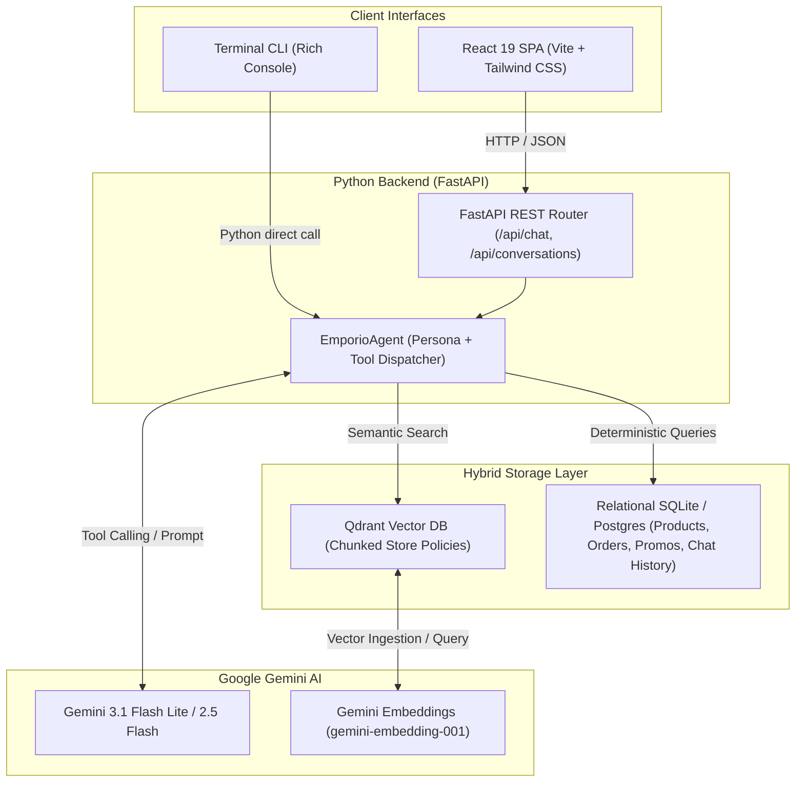

# 🎸 Empório da Música — AI Customer Support Agent

[](https://www.python.org/)
[](https://fastapi.tiangolo.com/)
[](https://react.dev/)
[](https://qdrant.tech/)
[](https://ai.google.dev/)
[](LICENSE)

An intelligent, full-stack customer support agent prototype built for **Empório da Música**, a traditional musical instrument store based in Campo Grande, MS.

Designed for the **Artefact AI Engineer – Full-Stack para Aplicações com IA Generativa** technical evaluation.

---

## 📑 Table of Contents
- [1. Executive Summary](#1-executive-summary)
- [2. System Architecture](#2-system-architecture)
- [3. Justification of Technical Decisions](#3-justification-of-technical-decisions)
- [4. Project Structure](#4-project-structure)
- [5. Getting Started & How to Run](#5-getting-started--how-to-run)
  - [Prerequisites](#prerequisites)
  - [Quickstart: Automated Local Run](#quickstart-automated-local-run)
  - [Alternative: Interactive Terminal CLI](#alternative-interactive-terminal-cli)
  - [Alternative: Docker Compose](#alternative-docker-compose)
  - [Running Automated Tests](#running-automated-tests)
- [6. Agent Persona & Guardrails](#6-agent-persona--guardrails)
- [7. Recorded Interaction Scenarios](#7-recorded-interaction-scenarios)
- [8. Known Limitations & Production Roadmap](#8-known-limitations--production-roadmap)
- [9. AI Coding Assistant Workflow](#9-ai-coding-assistant-workflow)

---

## 1. Executive Summary

Empório da Música's human customer service team was overwhelmed with repetitive inquiries: product pricing, catalog availability, order tracking, store hours, and warranty/return policies.

This project delivers a **production-ready, full-stack AI agent** combining:
- **Deterministic SQL Tools** for exact inventory queries, active discount calculations, and live order tracking.
- **Semantic Vector RAG (Qdrant)** for instant, authoritative retrieval of internal company policies (`políticas_da_loja.pdf`).
- **Google Gemini (with Tool Calling)** orchestrating user intent, selecting the right tools, and formulating empathetic, brand-aligned responses.
- **Persistent Conversation Storage** in SQLite (with easy PostgreSQL migration) preserving multi-turn chat sessions.
- **Modern React Chat UI & Rich CLI** featuring real-time tool inspection badges, quick suggestion chips, and responsive mobile-ready design.

---

## 2. System Architecture



### Retrieval & Decision Flow:
1. **User Message Received:** Sent via React Web UI or Terminal CLI to `/api/chat`.
2. **Context Assembly:** Conversation history loaded from SQLite and structured into Gemini `Content` turns.
3. **Autonomous Reasoning & Tool Execution:**
   - When the user asks about **policies, returns, hours, or shipping**: Agent calls `search_store_policies(query)` against Qdrant.
   - When the user asks about **guitars, prices, or filters**: Agent calls `query_products(...)` with SQL parameter filtering.
   - When the user asks about a **specific instrument (e.g. Takamine GD20)**: Agent calls `get_product_details(...)`, detecting current price, stock, and past expired promotions.
   - When the user asks about an **order status**: Agent calls `check_order_status(...)`, fetching tracking codes and delivery estimates.
   - When the user asks about **accessories (strings, picks, cables)**: Agent activates the **Scope Guardrail**, politely redirecting to regional partners.
4. **Synthesis & Response Delivery:** Agent formats response using markdown tables and friendly tone, logging executed tool calls for UI transparency.

---

## 3. Justification of Technical Decisions

| Dimension | Choice | Justification |
| :--- | :--- | :--- |
| **Main Language** | **Python 3.11+** | Mandatory test constraint. Python offers native support for the official Google GenAI SDK, Qdrant client, SQLAlchemy, and FastAPI. |
| **Agent Architecture** | **Hybrid Tool Calling + Vector RAG** | **Pure RAG fails on math and inventory** (LLMs hallucinate stock counts and prices). **Pure SQL fails on natural language policies**. A hybrid architecture with Function Calling gives deterministic precision for data and semantic flexibility for policy text. |
| **LLM Provider** | **Google Gemini (`gemini-3.1-flash-lite`)** | Native multimodal and function-calling capabilities, extremely fast latency (< 1.5s), reliable reasoning, and high quota stability for customer support workloads. |
| **Vector Store** | **Qdrant (`qdrant-client`)** | State-of-the-art vector engine. Runs in **zero-friction embedded mode** (`qdrant_storage/`) requiring no external Docker daemon to run locally, while remaining 100% compatible with remote Qdrant clusters. |
| **Relational Database** | **SQLite + SQLAlchemy** | Serverless, zero-dependency persistence out-of-the-box for evaluators. Easily swapped for PostgreSQL by updating `DATABASE_URL`. |
| **Frontend UI** | **React + Vite + Tailwind CSS** | Fulfills the "Full-Stack AI Engineer" profile. Provides a clean WhatsApp-inspired UI with instant prompt suggestions and collapsible badges displaying real-time tool execution traces. |
| **Interactive CLI** | **Python Rich Console** | Enables instant evaluator testing directly in the terminal without compiling the web frontend. |

---

## 4. Project Structure

```
Artefact/
├── data/                                 # Challenge datasets
│   ├── desafio_tecnico_ai_eng - categories.csv
│   ├── desafio_tecnico_ai_eng - customers.csv
│   ├── desafio_tecnico_ai_eng - order_items.csv
│   ├── desafio_tecnico_ai_eng - orders.csv
│   ├── desafio_tecnico_ai_eng - products.csv
│   ├── desafio_tecnico_ai_eng - promotions.csv
│   └── políticas_da_loja.pdf
├── emporio_agent/                        # Core Python Agent Package
│   ├── config.py                         # Environment settings & paths
│   ├── db/
│   │   ├── database.py                   # SQLAlchemy engine & session factory
│   │   ├── models.py                     # Relational models & conversation schema
│   │   └── seed.py                       # Automated CSV data ingestion
│   ├── rag/
│   │   ├── embeddings.py                 # Gemini embeddings integration
│   │   ├── vector_store.py               # Qdrant client & similarity search
│   │   └── ingest_policy.py              # Semantic PDF chunking & Qdrant ingestion
│   ├── agent/
│   │   ├── persona.py                    # Store persona, guidelines & guardrails
│   │   ├── tools.py                      # Deterministic Python tools for the LLM
│   │   └── core.py                       # EmporioAgent ReAct loop & persistence
│   ├── api/
│   │   ├── main.py                       # FastAPI application & SPA mounting
│   │   ├── routes.py                     # REST endpoints (/chat, /conversations)
│   │   └── schemas.py                    # Pydantic DTOs
│   └── cli.py                            # Interactive terminal runner
├── frontend/                             # React Web Application
│   ├── src/
│   │   ├── App.jsx                       # Chat UI with tool execution inspection
│   │   ├── index.css                     # Tailwind styling & markdown tables
│   │   └── main.jsx
│   ├── package.json
│   └── vite.config.js
├── examples/                             # Evaluator Deliverable
│   └── conversations/                    # 6 documented real interaction transcripts
│       ├── cenario_1_catalogo_violoes_ate_1000.md
│       ├── cenario_2_informacoes_loja_e_horarios.md
│       ├── cenario_3_preco_e_promocao_takamine_gd20.md
│       ├── cenario_4_politica_devolucao_arrependimento.md
│       ├── cenario_5_rastreamento_e_status_pedido.md
│       └── cenario_6_fora_de_escopo_acessorios.md
├── tests/                                # Automated Test Suite
│   ├── test_tools.py
│   ├── test_rag.py
│   └── test_api.py
├── scripts/
│   └── generate_scenarios.py             # Reproduces real conversation test traces
├── Dockerfile                            # Production multi-stage Docker build
├── docker-compose.yml                    # 1-command container orchestration
├── requirements.txt                      # Python dependencies
└── README.md                             # Technical documentation
```

---

## 5. Getting Started & How to Run

### Prerequisites
- Python 3.11+
- Node.js 18+ (only needed if building frontend locally)
- A Google Gemini API Key ([Get one free at Google AI Studio](https://aistudio.google.com/))

---

### Quickstart: Automated Local Run (Recommended)

1. **Clone the repository:**
   ```bash
   git clone https://github.com/luisciaramicoli/Artefact.git
   cd Artefact
   ```

2. **Configure your Gemini API Key:**
   ```bash
   cp .env.example .env
   # Open .env and insert your GEMINI_API_KEY
   ```

3. **Set up Python Virtual Environment:**
   ```bash
   python3 -m venv .venv
   source .venv/bin/activate
   pip install -r requirements.txt
   ```

4. **Initialize Database & Ingest Policies into Qdrant:**
   ```bash
   python emporio_agent/db/seed.py
   python emporio_agent/rag/ingest_policy.py
   ```

5. **Start the Backend Server (with prebuilt React UI):**
   ```bash
   python -m emporio_agent.api.main
   ```
   Open your browser at **`http://localhost:8000`** to interact with the full-stack web chat!  
   API documentation is available at **`http://localhost:8000/docs`**.

---

### Alternative: Interactive Terminal CLI

To test the agent directly in your terminal with rich formatting and instant tool call logs:

```bash
source .venv/bin/activate
python -m emporio_agent.cli
```

---

### Alternative: Docker Compose

Run the entire application in an isolated container with one command:

```bash
docker compose up --build
```
The full application will be live at `http://localhost:8000`.

---

### Running Automated Tests

A comprehensive test suite validates database querying, promotional calculation, Qdrant vector retrieval, and FastAPI endpoints:

```bash
source .venv/bin/activate
pytest tests/ -v
```
All 8 test suites execute and pass in under 3 seconds.

---

## 6. Agent Persona & Guardrails

The agent adheres strictly to the internal policy manual (`políticas_da_loja.pdf`):

1. **Musical & Welcoming Tone:** Rooted in Campo Grande, MS (Rua 14 de Maio, 3200). Treats every customer like a fellow musician.
2. **Strict Scope Enforcement (The Golden Rule):**
   > *"Trabalhamos exclusivamente com instrumentos musicais — não comercializamos acessórios como cordas, palhetas, cabos, cases, pedais ou amplificadores." (Manual, p. 2)*
   - The agent detects accessory inquiries and politely explains that Empório da Música focuses 100% on instruments, suggesting local partner music shops.
3. **Zero Price/Stock Hallucination:**
   - Always invokes `query_products` or `get_product_details` before quoting prices or stock quantities.
4. **Promotion Transparency:**
   - Detects expired promotional campaigns (e.g. Takamine GD20 past 12% discount) and transparently informs the customer that the seasonal campaign ended, presenting table prices and standard payment terms (5% off on PIX, 12x credit card).
5. **Consumer Protection & Return Policies:**
   - Accurately applies the Brazilian Consumer Defense Code (CDC Lei 8.078/90): 7-day remorse return window for online/remote orders, full refund, and free reverse shipping.

---

## 7. Recorded Interaction Scenarios

All scenarios required by the Artefact prompt were tested against live data and documented in [`examples/conversations/`](examples/conversations/):

| Scenario | Objective | Tools Used | Transcript Link |
| :--- | :--- | :--- | :--- |
| **Scenario 1** | Search guitars under R$ 1,000 | `query_products(category_name='Violões', max_price=1000)` | [View Transcript](examples/conversations/cenario_1_catalogo_violoes_ate_1000.md) |
| **Scenario 2** | Store address & operating hours | Direct Persona Knowledge / `get_store_info` | [View Transcript](examples/conversations/cenario_2_informacoes_loja_e_horarios.md) |
| **Scenario 3** | Takamine GD20 price & expired promo | `get_product_details('Takamine GD20')` | [View Transcript](examples/conversations/cenario_3_preco_e_promocao_takamine_gd20.md) |
| **Scenario 4** | Online return remorse (7 days CDC) | `search_store_policies('devolução por arrependimento')` | [View Transcript](examples/conversations/cenario_4_politica_devolucao_arrependimento.md) |
| **Scenario 5** | Order #1 live status & tracking | `check_order_status(order_id=1)` | [View Transcript](examples/conversations/cenario_5_rastreamento_e_status_pedido.md) |
| **Scenario 6** | Out-of-scope refusal (strings/picks) | Scope Guardrail Enforcement | [View Transcript](examples/conversations/cenario_6_fora_de_escopo_acessorios.md) |

---

## 8. Known Limitations & Production Roadmap

Given the 2-day prototype timeline, here are current architectural boundaries and what would be implemented for enterprise production scale:

1. **Hybrid Vector + Lexical Search (BM25 + Dense Qdrant):**
   - *Current:* Pure dense semantic vector retrieval via `gemini-embedding-001`.
   - *Roadmap:* Implement Reciprocal Rank Fusion (RRF) combining sparse BM25 keyword matching with dense Qdrant vectors to handle exact alphanumeric model numbers even better.
2. **Multi-Agent Collaboration & Supervisor:**
   - *Current:* Single agent orchestrator with multi-tool calling.
   - *Roadmap:* Implement specialized subagents (e.g. `CatalogSpecialist`, `LogisticsSpecialist`, `PolicyAdvisor`) supervised by a Router agent using LangGraph.
3. **Observability & LLM Evaluation Framework:**
   - *Current:* Python logging and unit tests.
   - *Roadmap:* Integrate Langfuse or OpenInference tracing to track token usage, latency, and automated Ragas / TruLens evaluation benchmarks (Faithfulness, Answer Relevance).
4. **Distributed Storage:**
   - *Current:* Local SQLite and embedded Qdrant.
   - *Roadmap:* Transition to Managed PostgreSQL (Amazon RDS / Cloud SQL) with connection pooling (PgBouncer) and Qdrant Cloud.

---

## 9. AI Coding Assistant Workflow

In compliance with Artefact's evaluation guidelines, here is the transparent breakdown of how AI tools were utilized during development:

- **AI Tool Used:** Google Antigravity & Gemini Pair-Programming Assistant.
- **Workflow & Division of Labor:**
  1. **Architecture & Design:** Defining the hybrid deterministic-plus-vector approach (SQL for numbers, Qdrant RAG for policies) to prevent LLM hallucinations.
  2. **Data Pipeline:** Rapid generation of SQLAlchemy models matching the 6 CSV schemas and PDF extraction logic using `pypdf`.
  3. **Debugging Edge Cases:** Diagnosed a subtle Python 3.14 typing incompatibility where `google-genai` strict type deserialization rejected integer values into `Optional[float]` tool parameters, resolved via `Union[int, float, None]`.
  4. **Frontend Scaffolding:** Accelerated Vite + React 19 + Tailwind CSS setup and created the interactive tool inspection drawer.
  5. **Verification & Testing:** Authored automated Pytest fixtures and live scenario validation scripts.

*The AI assistant acted as an accelerator for boilerplate, test creation, and debugging, while system architecture, domain guardrails, and design decisions were strictly directed to meet Artefact's case requirements.*

---

## 👤 Author

**Luis Gustavo Bonfim Ciaramicoli**  
Candidate for **AI Engineer – Full-Stack para Aplicações com IA Generativa** at **Artefact**  
- **Email:** [luisgustavobonfim996@gmail.com](mailto:luisgustavobonfim996@gmail.com)  
- **GitHub:** [github.com/luisciaramicoli](https://github.com/luisciaramicoli)  
